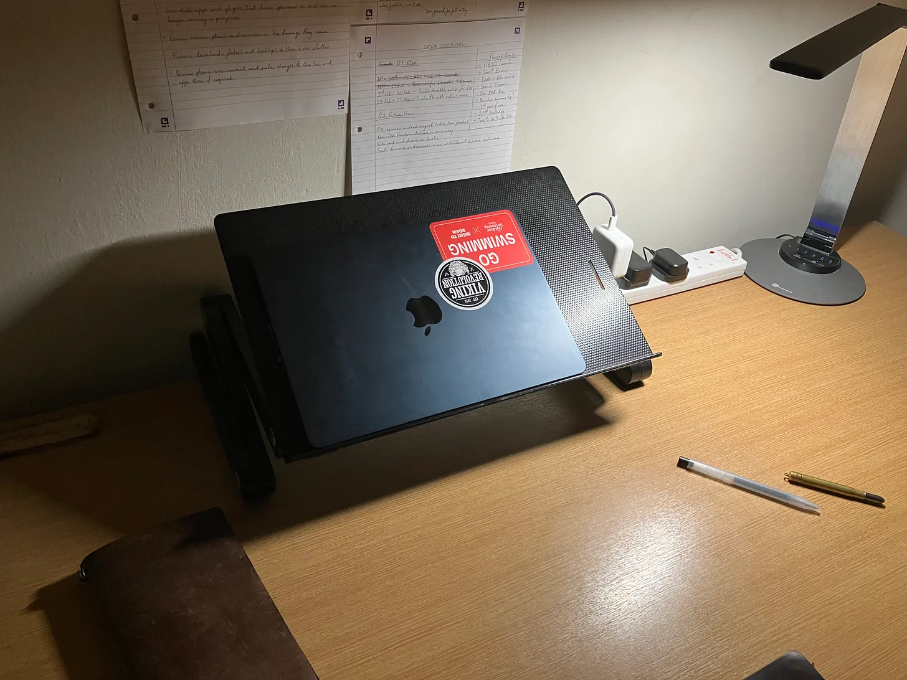

It’s been a whole year since I first encountered Cal Newport’s book *Digital Minimalism*.

A whole year since it **radically changed** my relationship with technology.

A whole year of progress **beyond what I thought I was capable of**.

Here’s what the book taught me, from the digital declutter to reclaiming free time, and the actionable advice that you too can put in place to use technology without being swallowed.

Let’s dive in…

## Decluttering Digital Environments

We all spend hours per day in our digital environments, making it important that it’s an **effective space to work**.

Regularly review the tools that you use to get work done. This makes sure that we’re using only what we need to produce output efficiently.

<figure>

</figure>

When I do this, I remove tools that aren’t needed in my workflow, so I don’t waste time worrying about things that won’t improve my creative output.

Newport emphasises that people should spend time away from digital environments when they’re not working.

This means you’re going to have to plan some leisure time because being disconnected from the digital world will feel unnatural, especially to start with.

Your leisure plan should contain:

- **Objectives** - goals that you want to accomplish through the leisure time

- **Habits** - behavioural rules that you stick to during leisure time throughout the season

By planning, you become more intentional with your time, meaning you’re more likely to stick to rules that you set yourself.

Newport recommends you to create something of value in the physical world during your leisure time - he believes that this leads to higher fulfilment than producing something digital.

## Social Media and Consumption

This was one step that I took to implement Digital Minimalism in my life. I’m sharing it with you because of the huge benefits I’ve noticed, which I want you to experience as well.

Once I’d adopted Digital Minimalist strategies in my life, my screen time **halved**, and stayed there.

I began to realise how much time I’d spent on services that pump unending streams of data through our heads. Instead of continuing to expose myself to this, I began to engage in high-quality leisure activities.

Guess what?

It’s much more fulfilling building connections with people you know in real life than leaving a like on their Instagram posts.

## Increasing Creative Output

What is there to do now you don’t consume? Simple:

**Create, create, create.**

It’s time to balance the scales of create vs consume. There are many people in the world who just consume. Only a small proportion of people give back, creating value for other people to benefit from.

The skills you learn from creating will serve you for the rest of your life. It’s how you earn money - if you don’t create value, why should anyone pay you?

It’s true that you can learn and gain value from mindful content consumption, but a lot of us spend too long consuming content that won’t benefit our lives.

Spend time out of the consumption loop so you can better see what provides real value when you return.

## Long-Term Meaning vs Short-Term Satisfaction

For maximum benefit from these principles, adopt them into your life **for good**.

If you hold these values, then it’s you who picks your tools and systems true to your principles, not the principles of others trying to steal your attention.

Instead of distracting yourself by scrolling, **chase increased fulfilment** by using technology to pursue your goals and purpose.

> *“Prioritise long-term meaning over short-term satisfaction.”* – **Cal Newport**, *Digital Minimalism*

**Which will you choose?**
