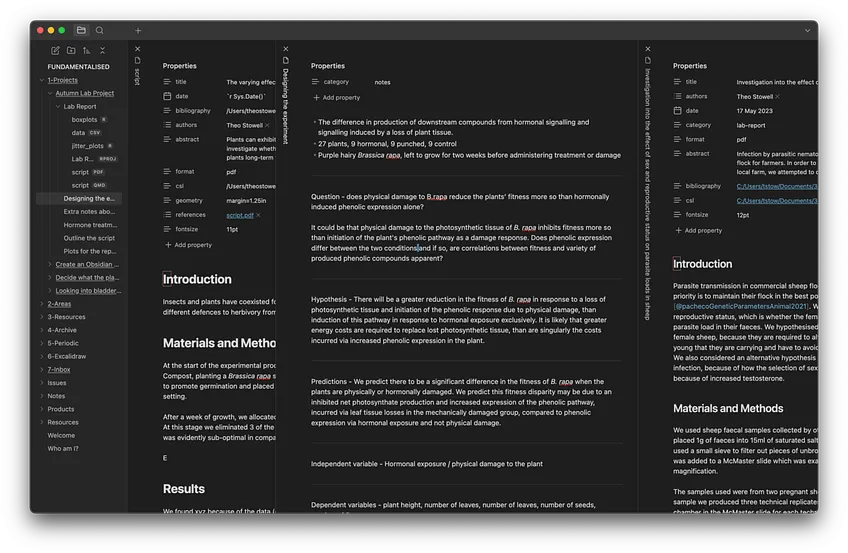

<figure>

</figure>

This is what my computer screen looked like for most of this afternoon.

I have a lab report due at the end of the month so planning, drafting and coding plots in RStudio is in full swing.

The app I’ve been using to manage all of this? You can probably figure it out from the picture if you haven’t guessed already.

Obsidian. Just plain, offline, markdown-based notes. But the power behind the app is unbelievable.

Through community plugins, I can manage all of my references, open and edit Quarto markdown documents and run a command that renders the document into a nicely formatted PDF.

I can open the same project folder in RStudio and edit the R scripts for the plots seamlessly, whilst being able to edit the text of the main script with all the notes and past lab reports in my vault that I might need for reference.

It’s not just lab reports. I integrate Obsidian with the OpenAI API to generate module-relevant flashcards for my studies in a fraction of the time it would take for me to write them myself. This means I have more time to use the flashcards, helping me learn the course content better.

This is only half of my Obsidian usage and already I’ve integrated with AI and the command line.

On the other side of what I use Obsidian for, I have folders and folders of notes that contain my unfiltered thoughts that I can sift through at any time if I’m lacking creative ideas.

I’ve been sharing my writing on the internet since the start of the year. Obsidian has been the app that I’ve drafted *every single article, note and newsletter* within.

I can create folder notes and tables of related files and render my lists of Todoist tasks and ideas within my Obsidian notes. I can open my Zettelkasten of atomic notes next to my writing, so what you get on the screen is only one degree away from my most unprocessed and unfiltered thoughts.

I don’t often recommend tools because I understand that everyone’s use case is different. However, Obsidian has changed my life. If you’re someone who doesn’t need collaborative editing in their notes app, you *might* not benefit from using it. Everyone else, give it a try. I’m not sponsored, affiliated or coerced in any way to give this recommendation. It truly is a special tool.

I’ll be back next week, drafting the issue in Obsidian as usual.

See you then!

------------------------------------------------------------------------

**P.S.** *If you want to learn more about how I use Obsidian, PARAZETTEL is relaunching soon as PARAZETTEL V2. For more info,* *[check it out here](https://go.parazettel.com/)!*

------------------------------------------------------------------------

## What I’ve written this week…

[The Right Way to Develop Your PKM System](https://medium.com/obsidian-observer/the-right-way-to-develop-your-pkm-system-c3de4b792138) - Taking inspiration from biological evolution…

------------------------------------------------------------------------

## Quote of the week…

> *“When I need to focus, I turn off the Wi-Fi. I know I can’t remain dedicated to one task with an ocean of information beckoning to me from just the other side of a browser window.” —* **Tiago Forte**, *The PARA Method*

This is just another one of the reasons you should use an offline-based note-taking app like Obsidian!
