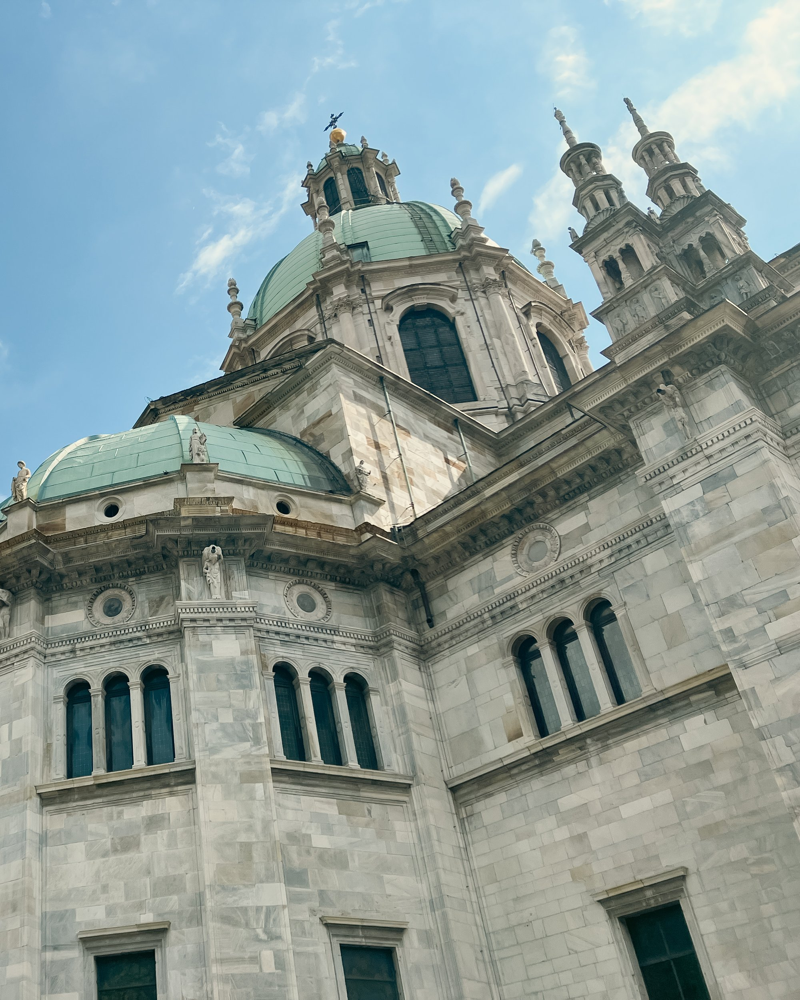
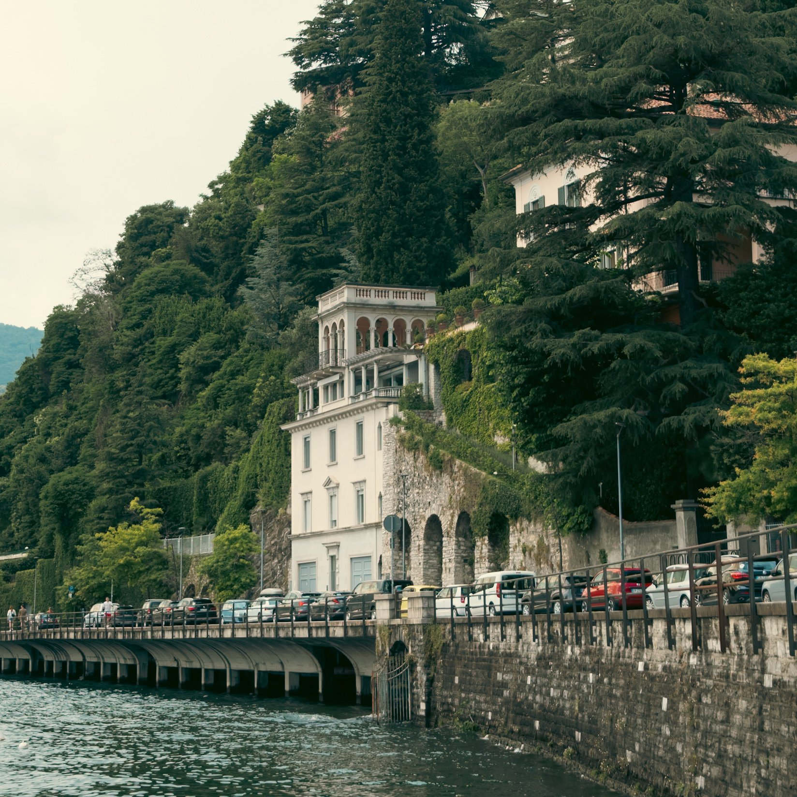
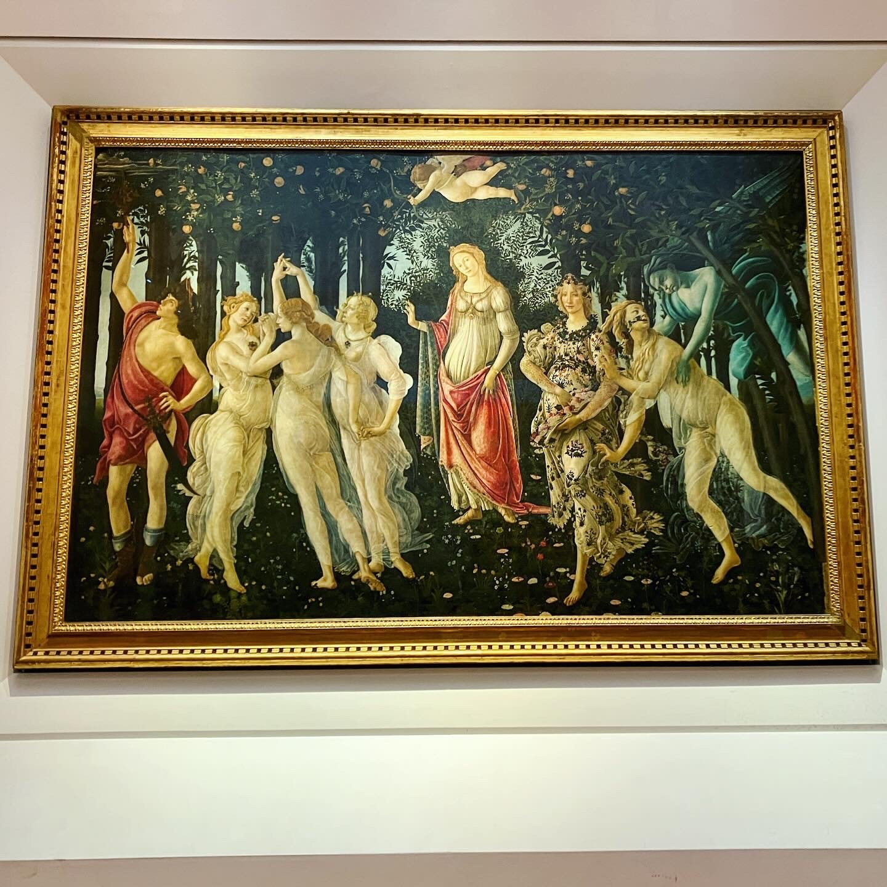
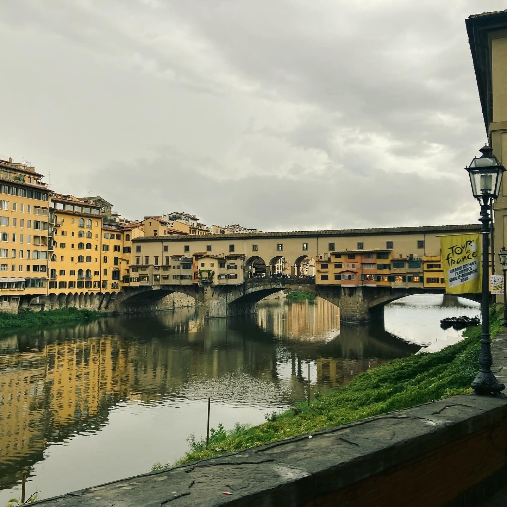
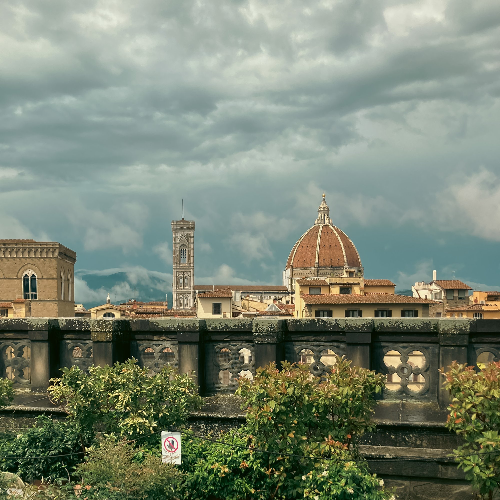
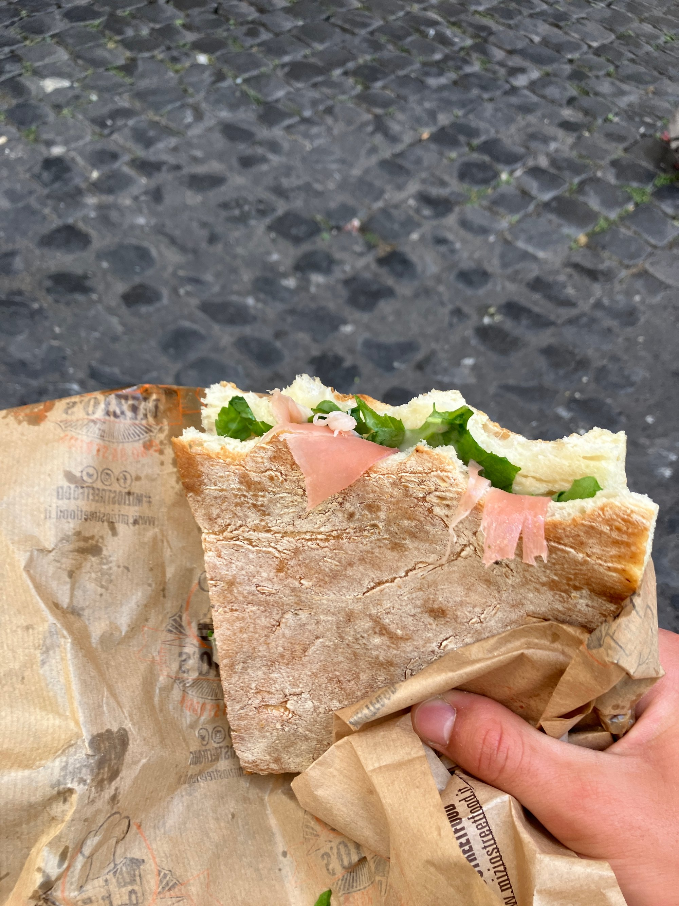
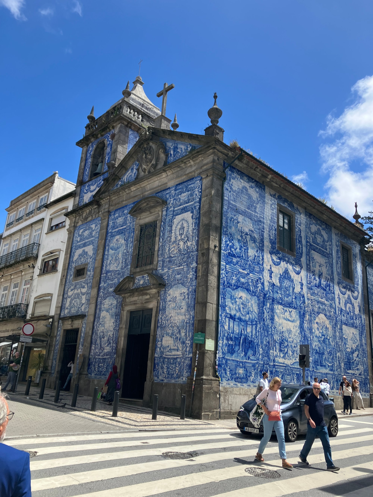

Happy Friday,

Thanks for being patient with me over the last couple of weeks while I was travelling. Here are some pictures for a peek into what I’ve been doing…

I flew back from Milan yesterday morning, got a good night’s sleep and now I’m back and ready to focus on writing and creating properly.

This was one lesson that I learned on the trip - to experience something in full, you have to de-optimise other areas of your life.

It took me a while to step away from creating business stuff while on holiday but eventually, I realised that I wasn’t going to be able to create to the quality I wanted to. Instead, I went all-in on maximising travel experience, knowing I’d come home and focus on writing soon.

After this realisation, I also noticed that this truth was only made obvious by the extreme example of travelling and being too preoccupied to get the laptop out and do any writing. But this doesn’t mean that it’s not a problem in the rest of our lives too…

It’s also much harder to spot what you must optimise or de-optimise in your daily activities. They’ve become ingrained at this point and we don’t give them much thought

So we must develop a framework that gives us no choice but to stay focused on the things that matter.

A basic way to do this, I’ve found, is to take a moment and be mindful of what you want to achieve, on the scale of a couple of weeks (like my holiday) and up to 10 years, or even your life.

I realised that juggling writing and business whilst I was travelling wasn’t optimising for the best experience whilst travelling to new places.

This led to me postponing writing and creating in favour of meeting new people, trying new things and drinking in the atmosphere where I was visiting.

And I’ve come out of the experience inspired, joyful and prepared to attack a new season of my life with more energy. Now I can prioritise writing and sharing thoughts and ideas without compromise.

Although in the short-term this might not have been good for business or my online presence, I’ve opened my mind and seen the world, which is something I’d never done before. And that’s beneficial on an ’entire life’ timeline, enriching my memories, experience and street smarts.

In your daily life, where there’s not a clear distinction between useful and non-useful activity, this method can be taken further by breaking things down into projects that have set end dates and outcomes that you want to achieve.

This helps stop you from getting sidetracked or discouraged by not being able to see progress, completion or results.

Interestingly, this aligns a lot with the criteria in which you enter a flow state, which is the highest form of prioritisation - complete focus on the current task or experience, neglecting all things that don’t directly help the present activity.

So continue to set yourself goals and tasks and align to them, making it easier for you to optimise for success in different areas of your life at the right time. Building mindfulness and a goal review practice will help with this a lot too.

Look out for more content from me now that I’m back home and planning to write and post a lot more! As always, thanks for reading and I’ll talk to you soon…

— Theo

------------------------------------------------------------------------

## Last week’s video issue…



***Read the issue - [055 • A few short thoughts from my first time travelling](/fm/055/)***

------------------------------------------------------------------------

## What I’ve photographed this week…

Although I’ve not written a lot in the last few weeks, I have been taking photos. Here are some of my favourites from the trip…

