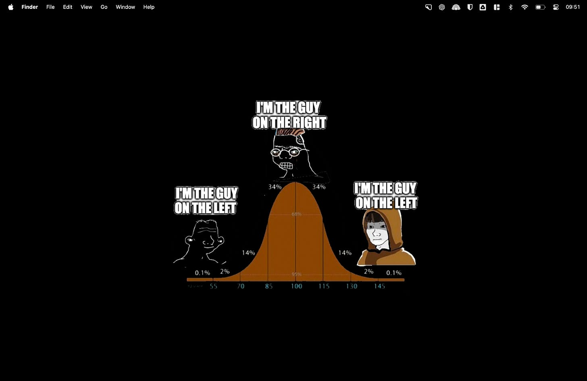
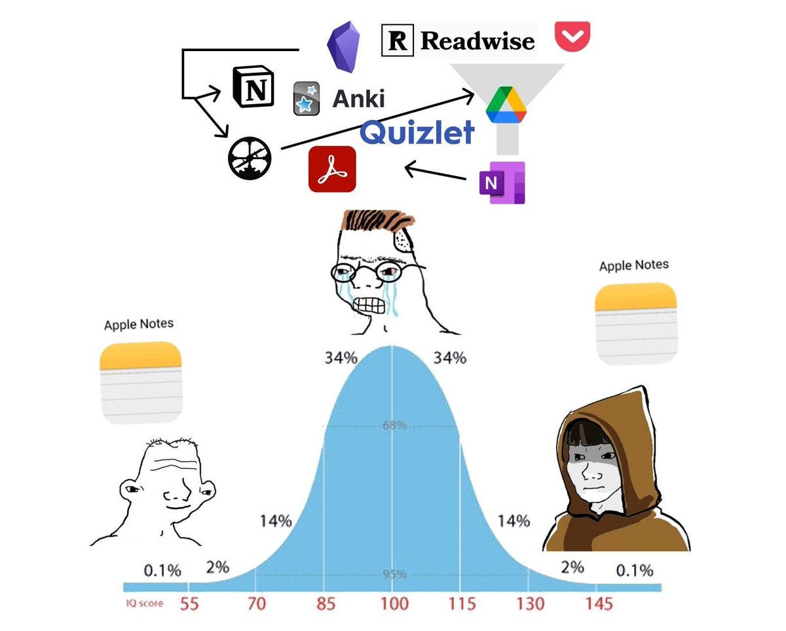
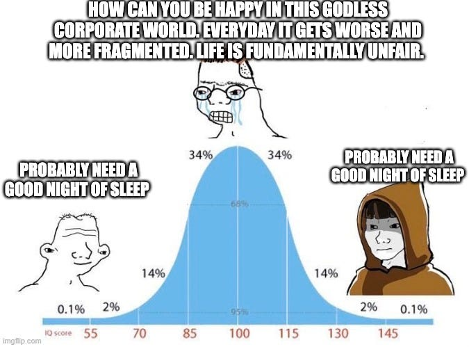
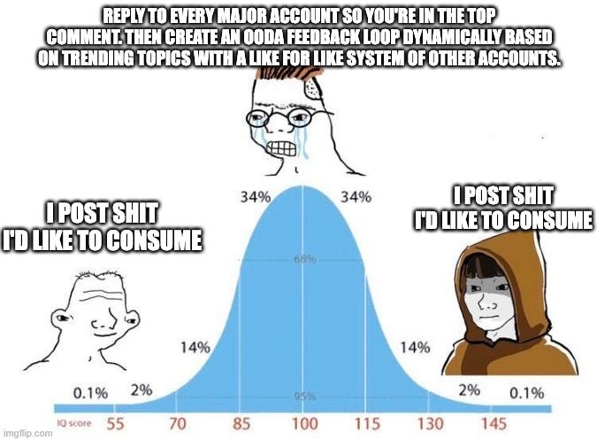

For the longest time, my phone and laptop’s background wallpapers were just plain black. But recently, that changed.

Now they look like this…

<figure>

</figure>

This is the midwit meme. And it’s a better mental heuristic than it might appear. The first time I came across it was in the context of productivity…

<figure>

</figure>

But there are countless other examples…

<figure>

</figure>

<figure>

</figure>

There is so much to be taken away from the lesson here. We’re all striving to be the sage on the right. But we can’t ever get there. Every one of us is the person in the middle metaphorically, but we can shortcut our route to the same result as the sage by doing the stupidly simple thing, whether we think it’s right or not.

I’ve fallen for over-complicating things so many times in the past, the most recent of which was mentioned in the issue I shared a couple of weeks back…

- [078 • One step after the other, no matter the time of year](/fm/078/)

Instead of going down the rabbit hole of a purchasing whole new domain just for link shortening and better analytics for optimising my business traffic, I could have just posted more content that helped people.

But there we go - it’s a lesson learned over again. And that’s why I put it on to my phone and laptop wallpapers. Because it’s so easy to forget. And I want to do the simple thing much more often.

Just a couple of days ago I was sitting around thinking about how I wanted to do a multiple-step review and goal-setting process for the end of this year and the start of the next one. Then I realised I was overdoing it again, decided on a few things to prioritise in the new year, and just got on with my work.

There are some caveats to making all of life’s decisions through through the lense avoiding midwit(ry?) though. We have to spend some time in the middle striving to get to the right-hand side of the graph to learn things. Of course, we can take the shortcut to the final outcome by doing the stupidly simple thing if we so wish, but a lot of insight comes from making mistakes in the journey and for this, we have to introduce a little bit of complexity.

How I see it, the skill is to learn to notice where doing the above would actually be worth the lessons and experience. There are a lot of places where the simple is better; most places in fact, but not all. Sometimes we can sacrifice the streamlining, be a bit of a midwit and go through an experience to learn its lessons first-hand.

My business is a good example - to someone on the outside who’s never seen how it works, it would look very complicated. But in reality, I started simple and built up without ever making things very complicated. It’s one or two welcome sequences in email marketing, a single website, a platform that does all the complicated stuff behind payment and fulfilment for me, and I’ve only just introduced my second marketing channel after two years of creating on the first.

It’s not as simple as it could be, that’s for sure. But I’ve learned a lot through taking the wrong roads and making the wrong decisions, which wouldn’t have happened if I’d chased keeping things so fundamental. So another skill to build is to be able to zoom in or out to the right extent so that you know how to apply the ‘simplicity’ thing.

Anyway - that’s the one overarching principle to living a better life that I’m trying to carry forward into 2025. I’m always trying to Fundamentalise things after all.

Have a happy new year,

— Theo

------------------------------------------------------------------------

## Last week’s issue (extended cut)…



***Read the issue - [079 • The best of 2024](/fm/079/)***
