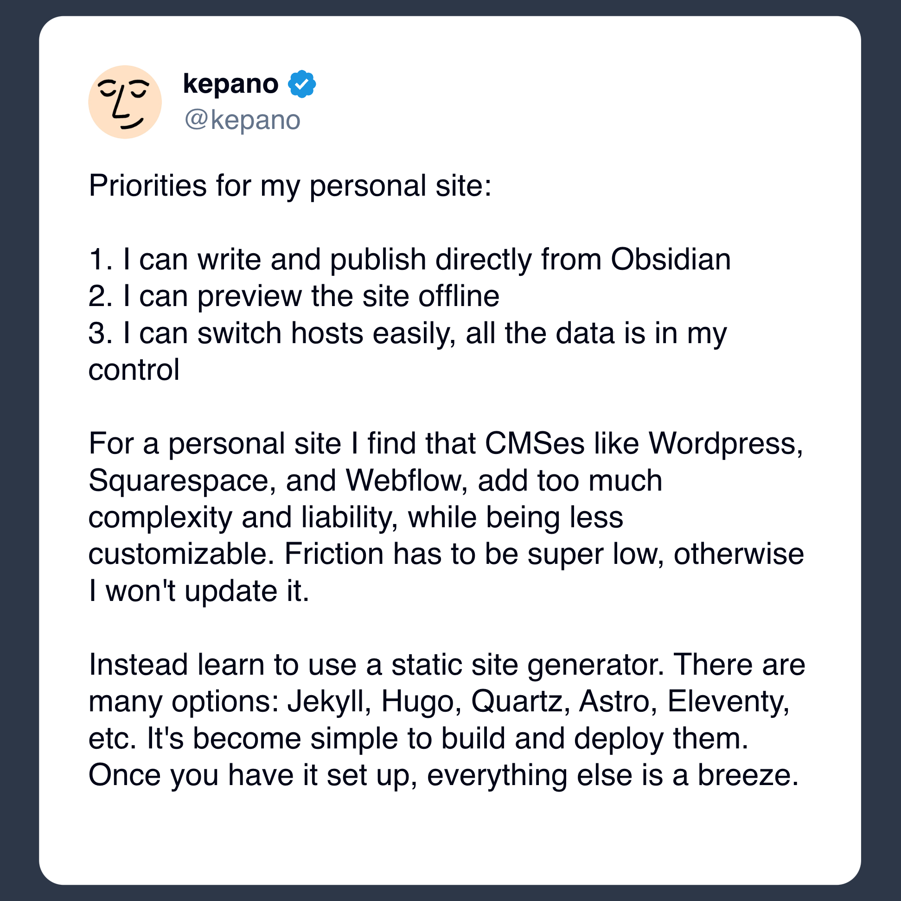

> **Note:** *This website still exists, it’s just a personal one at the domain [theostowell.me](https://theostowell.me/) now. It’s still made with the architecture that I put together before I wrote this piece.*

As you can see, things have changed around here again. And if you give me the next 5 minutes I’ll bring you up to speed.

A few days ago, I was procrastinating in the main library at university when I saw a tweet from Steph Ango, talking about using Obsidian and a static site generator to build a website based on text…

<figure>

</figure>

This was the push I needed to put a project into motion, one that I’d held off on for a long time.

Starting that afternoon in the library and culminating in a five-day sprint, I put together [https://fundamentalised.com/](/fm/) with nothing except the vision of a better home for my writing (Substack hadn’t been doing it for me).

I couldn’t code though (I still can’t), so how on Earth did I make this work?

Well, I’d been quite a large proponent of using AI for things in the past, from [personal development](/fm/081/) to troubleshooting code in RStudio for university report graphs. An AI-integrated code editor called Cursor had caught my eye, alongside the eyes of almost everyone technologically-inclined on the internet, so I’d installed it previously thinking that I’d give it a whirl for fun.

But I’d never gotten around to using it, so that afternoon I fired Cursor up for the first time and entered my OpenAI and Anthropic API keys and got to work.

With the knowledge of the AI models behind my programming, the only skills I really needed was a tangible idea of the site I wanted to build, and plenty tenacity for when things went wrong.

And go wrong they did - it took thirteen attempts before I managed the first successful deployment from Netlify, and I could put the URL [https://wip.fundamentalised.com/](https://wip.fundamentalised.com/) (no longer active) into the address bar and look at a website that I’d coded myself.

But eventually, after burning through several credit payments of API usage, I had a website that was completely functional. It had all my [past issues](/fm/) and [short essays](/writing/) available to read, and subscription forms connecting back to ConvertKit (now Kit, and still my favourite tool for emails, hands down) so I could continue sending issues as emails every weekend.

What staggered me was how relatively simple the whole process was with very little coding experience. I’ve got some technical knowledge and am good at pattern recognition, but I could tell you nothing more about different programming languages than being able to identify them by eye.

But I got everything working relatively painlessly, and now I’ve got a website that’s completely custom, my own, and editable from Obsidian.

That’s the real kicker. I’ve got a tool I’m completely used to using integrated with this website, so you can expect much more content coming from my direction soon, as I streamline things even further than they were on Substack.

And it’s here for the long term now. In only a year and a half, this is the fifth configuration of Fundamentalised that I’ve gone through, leaving Beehiiv, Obsidian Publish + Beehiiv, WordPress + ConvertKit and Substack in the dust. But I’m confident things are going to last a lot better now. Everything’s under my own control to an extent that didn’t exist before, and it’s cheap and low overhead to maintain.

This means more time for writing and sharing! But for now, I’ve got an exam for university so you might have to put up with another week of relative silence from me before I can start making the most of this new setup.

Either way, I appreciate you reading, as always, and I’ll see you next week!

— Theo

------------------------------------------------------------------------

## Last week’s issue (extended cut)…



***Read the issue - [082 • Connect with the people who make your effort worth it](/fm/082/)***
