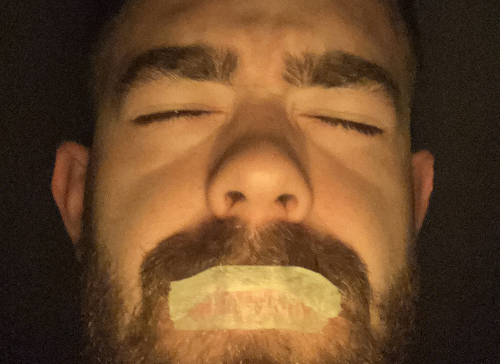
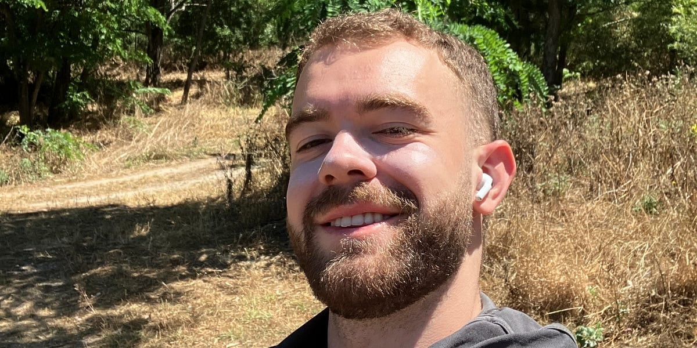

So here we are. Another Fundamentalised issue, the first since the end of March.

Quite a bit has changed, so settle down for around five minutes and I’ll tell you what’s been happening and what’s going to be happening for the foreseeable future.

One week ago, I sat my last university exam ever. The celebrations over the weekend were great, but I jolted awake on Monday morning at 5 am, wondering what the hell I was going to do with my life…

<figure>

</figure>

Now I have some ideas and plans, but that doesn’t paper over the fact that nothing’s concrete at the moment. I don’t know what house I’m going to be living in, and what I’m going to be doing for work.

Here’s what I do know - my friend [Archit](https://architsachdeva.com) and I are looking at Reading as a place to set up, and aim to move in by the end of July. He’s come to the end of a degree apprenticeship with Cisco, just as I’ve come to the end of my time in Sheffield, and we’re both out of jobs for a short while,

This means we can’t make the move immediately so for now, I’ll be moving back home to my family in Bristol. However I’m going to leave the majority of my stuff in storage in Sheffield so that we’ve no choice but to take action, and I’ll travel back up again to make the journey down to the new apartment together when we pull through with jobs, which is the full-time aim at the moment.

Anyway, as for Fundamentalised as a publication, I’ve decided to make it more story-oriented as I move through this interesting and formative period in my life. There’ll be some lessons, but it’ll be hard to put them out whilst what I’ve got going on is anybody’s guess.

And I think that the stories will be more relatable, as if there’s anyone out there reading that’s going through an in-between time themselves, there might be some peace in reading that others are experiencing the same.

A little more than a year ago, I was in Portugal for the first time and announcing the start of weekly video issues alongside the written work that I was putting out. I promised a year of this before deciding whether I was going to continue in issue 054 below:

#### [054 • My methods for harnessing intuition and flow state](/fm/054/)

*Hello again,*

It’s been a year, if not 52 new issues, and I’ve chosen not to commit myself to filming video issues from now on. This will make it lower-friction to publish on time every week, and make it more meaningful when I do have something to film and share.

A new angle that I might take is posting more creative and personal work on my [photo and video YouTube channel](https://youtube.com/@tstowphoto). There’s a vlog on the channel now from when my friend and I walked from Sheffield to Manchester last autumn…

#### [070 • Walking very far + turning twenty-one](/fm/070/)

*The other day I walked from Sheffield to Manchester with my university housemate.*

Although Archit and I (probably) won’t be doing anything as extreme, it’s going to be an exciting time and I want somewhere to be able to share my personal thoughts and anecdotes visually, so I’m doing it this way.

The YouTube channel I’ve been using up until now is more business-related, and I want to keep it that way to make sure that I’m funnelling the right audience to the marketing and products that I maintain on the backend.

[PARAZETTEL’s](https://parazettel.com/) going to be what I continue to build in the meantime of moving to Reading, as I don’t want to get into a job position that’s boring and time-intensive whilst I’m living at home.

I’ll make enough through this to pay rent to my parents, and Archit and I will keep pressing for job roles in the Reading/London area. The second one of us gets one, it’s packing up time again, to make the move for good.

The reasons we’re so keen to get this next stage of our lives started are many. One, I live in quite a small town back home. It’s got good primary and secondary schooling, but aside from that, there’s not much going on. Even though I can drive, I don’t own a car and it’s over an hour to Bristol on the bus.

Archit’s also worked remotely throughout the entirety of his degree apprenticeship, and wants to get away from home. And London is the best place to go when it comes to tech and building a network of people (something he’s already maximised in our small corner of Sheffield).

I picked up some photo and video gigs with local businesses earlier this year whilst I was finishing off the degree too, and with any luck I’ll be able to do some more of this part-time as well when I’ve moved out. Luckily, London seems to be the best place for this as well, even if what I end up doing takes more of a writing and marketing angle.

For all this talk, nothing’s for certain. Right now, it’s just going to be me hammering the job applications. I’ve tried Healf’s graduate and creative roles already ([where I get my supplements from](https://healf.com)), and I’ve also applied to be a creative at Runna, the running app company that makes custom training plans regardless of your experience and goals.

Archit tells me that I should branch out and be slightly less discerning with the companies that I apply to work with for now but to me, there’s no harm in prioritising the ones that I have an active appreciation of first.

------------------------------------------------------------------------

That’s the story so far. Thanks for reading for the last two years - I’m looking forward to continuing to share the escapades and lessons that I go through when it comes to real-life existence. It’s time to leave the crèche and join the real world, and I’m all here for it.

If you’re not already, you can sign up over at [go.parazettel.com](https://go.parazettel.com/), where you get a free 14 days of note-taking and personal knowledge management insight. I take notes using Obsidian, so if you do as well, you’re going to get a lot of value and insight to how I take notes, from theory to workflows, by being on the list.

Aside from that, I think that’s pretty much it! I’m going to be posting new issues again every single weekend (Friday, Saturday or Sunday, I promise it won’t be Monday/Tuesday like I ended up doing before, now that I just have to type and publish rather than record I should be better at this), so I’ll see you next week!

Thanks for being here,

— Theo
