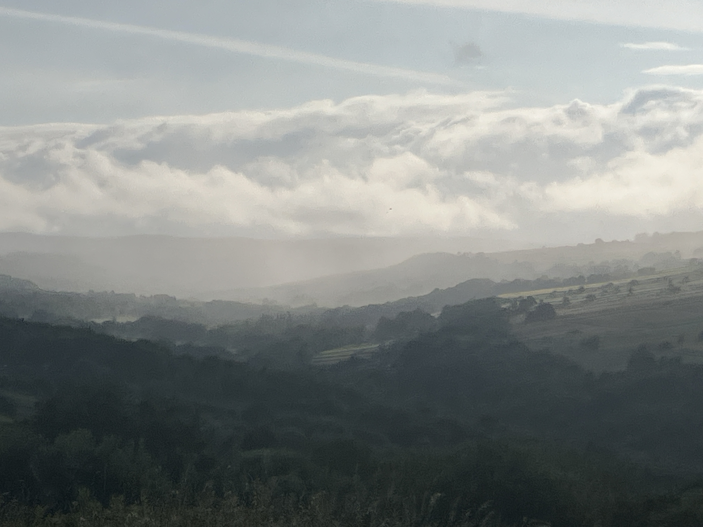
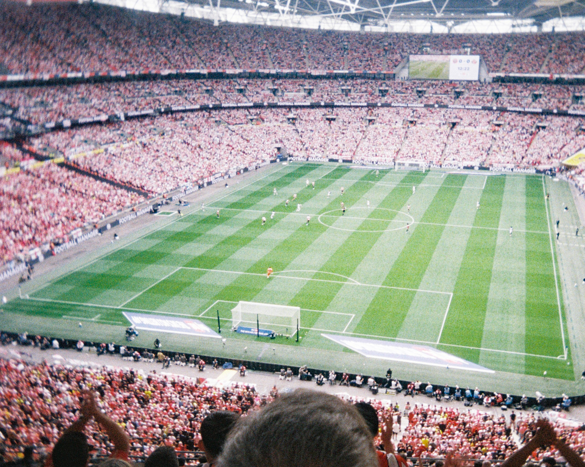

*Something a bit different, but I thought I owed it to the city to write a roundup of what I’d been getting up to there…*

------------------------------------------------------------------------

Just yesterday I moved back home to my parents’ house near Bristol, after spending over 2.5 years mainly living in Sheffield to study.

It’s a strange feeling, and a little bittersweet (seeing as I’m progressing, but have lost a lot of the fun out from Sheffield), but I’m going to make the most of my recent knowledge and write this short guide/series of stories about the city.

Here we go…

## Parks and green spaces

We’ll start with this one, because it’s one of the things that Sheffield is most well-known for. It’s often cited that the city is one of the greenest in Europe, and that it has about 5 trees for every resident (how do they work that out?!).

The popular student parks are Crookes Valley Park, where you can go swimming in the water. I did this back in my second year, where I lived a three-minute walk away from the park - you have to walk back freezing and sopping wet after you’ve gotten out, so it’s not something I’ve been able to do this year.

Weston Park is out the back of Firth Court, one of the most photogenic buildings on the entire campus, and the park is very nice as well if you want to chill out or kick a football around.

This third year, living further out, by Crookes high street, Bolehills was a popular spot. From there, you could look out over the Peak District and watch the sunset. It got ever so busy during sundown over the last few weeks of spending time there, but it was worth it every single time because of the beauty of the moment.

<figure>

</figure>

Here’s an image from there, looking out towards the Peak District, although I couldn’t find a sunset one, so you’re going to have to make do with this.

## Establishments

There are a few ways that I can choose to do this section. I think I’ll start with the places that I spent most of my time, and then spread out to some more popular spots…

### 1. Cloud Coffee, Crookes (@cloudcoffeeco)

This was my home away from home for the whole of my third year whilst living up near Crookes. I visited a number of times every week for hours, enjoying the highest quality coffee and ambience from Con and Aaron.

During my first semester, I wrote about 90% of my literature review from this place, and gained a first-class grade. That should tell you enough about how nice it is there and how great a spot for work it can be if you need it to be.

### 2. Beanies Wholefoods

During my second year, I lived just across the road from Beanies, above a second-hand furniture shop (that’s now a cafe, and I’m gutted).

Beanies, though, was always fantastic. Organic fruit and veg, wholefoods, coffee beans and even a selection of basic hygiene products that were actually good for you - think fluoride-free toothpaste, unscented soaps and the like.

But the thing that I purchased the most from Beanies was bread. They sold a fantastic selection of loaves that were freshly baked and delivered every morning, and it was so easy to just walk out the front door and across the road to get a loaf (if I hadn’t made any of my own in my bread machine).

### 3. West Street

In Sheffield there is a road that runs from the university in the west, to the most central part of the city, and it’s where almost all the partying and nights out take place. There aren’t any clubs, but there’s a great selection of bars and it’s almost always busy, even on weekdays (because students will go out whenever they feel like it).

I spent more than a few nights in West Street and have some of my fondest and most chaotic memories originating there. It’s a place I had to include on this list, especially since I didn’t really want to go over the university buildings like libraries and things - I want this guide to be useful if you’re going to Sheffield, even if you aren’t studying there.

So West Street and the neighbouring Division Street and Carver Street are the best places you want to go for the most energy and fun. In particular, try out Molly Malone’s and West Street Live for a good place to start.

## Exercise and health

I’ve been training at the university gym pretty much from the first day that I got to university to the last. When it was time to pick up my ID card on the first day, I’d already paid for my membership, so I managed to sneak in for 20 minutes of training before the gym closed that day, to check it out.

Just before I left, I crossed 300 sessions there, but I’ve trained at other places too. There are Gym Group gyms in the Moor and Kelham Island, and a PureGym near the Leadmill (an iconic Sheffield club venue near the station), and they all do the job perfectly well.

An honourable mention goes to Station Gym a little way out of town, at Manor Top - they’ve converted a fire station into a gym and it’s great, with plenty of good machines and specialist strongman equipment.

My university housemate is also a big fan of Sheffield United, so I ended up supporting and watching a lot of football matches with him, the finale of which was the EFL Championship playoff final at Wembley Stadium in London just a month or so ago…

<figure>

</figure>

Sheffield lost, but it was a bucket list moment going to watch a team at Wembley, and the day was exciting all the same.

------------------------------------------------------------------------

That’s the end of the roundup of this fantastic city. Every time I speak to someone about Sheffield, they mention that a lot of people graduate and stay in the city for life. Although I’m not doing this myself, I can see why others might - it’s busy, but keeps a personal, ‘small town’ feeling. It’s always got events going on and is very cultural, with a lot to try out, no matter what you’re into.

If you ever visit, make sure to check out some of the places that I’ve listed here, and I’ll see you next week!

— Theo

**P.S.** *There might be some updates with the job hunt next week, but I’m not one to announce the transfer before it’s been finalised, as such, so you’re going to have to wait and see.*

------------------------------------------------------------------------

## What I’ve been writing…

I forgot to do this last week when I reintroduced the new update for Fundamentalised, but I’ve still been writing things whilst I’ve been away. Here are a couple of personal essays that I’ve kept on the portfolio website rather than cluttering up this newsletter - you can click the links to read…

[Ideas beget more ideas. Share them.](/ideas/)

[Purposeful action is oxygen](/purposeful-action/)

------------------------------------------------------------------------

## Photographs I’ve been taking…

I’ve also been shooting photos for local businesses, which relieves me because I feel as though there have been many issues where I’ve talked about doing this and then not pulled through.

The first couple of clients have been [my barber Mo](https://tstowphoto.com/mo-co), and [a coffee shop a little way out of the city centre of Sheffield](https://tstowphoto.com/pipers-coffee) that was opening first back in April.
