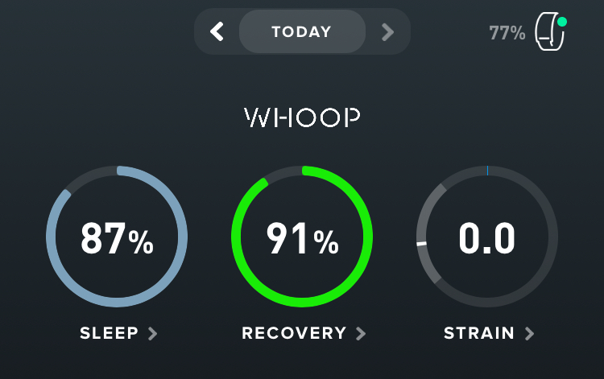
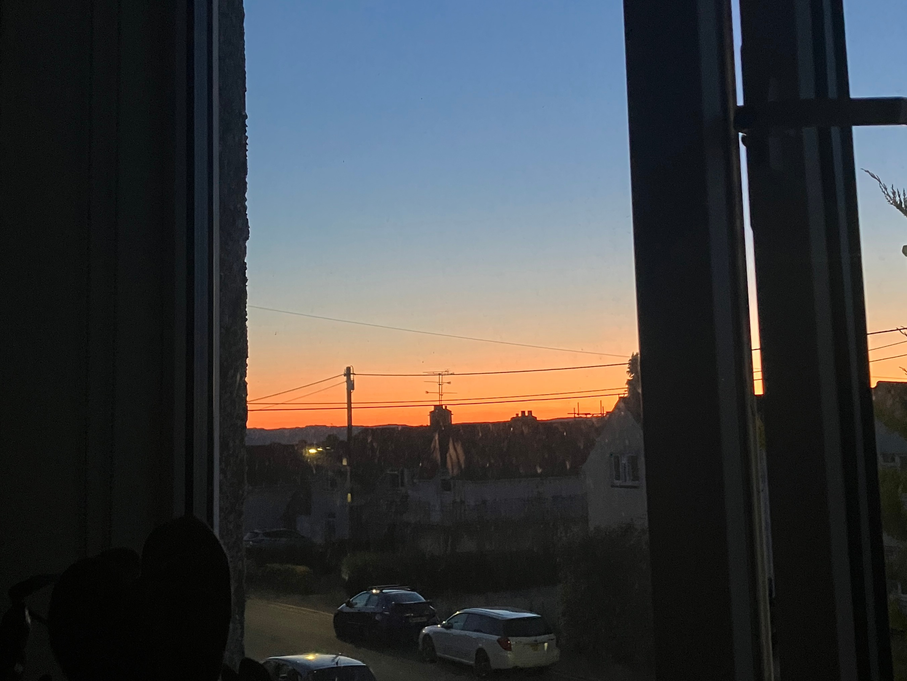

Happy Thursday,

I’m bringing an issue to you a little earlier this week. Tomorrow and Saturday I’m off to Reading to look at apartments with Archit, and I don’t trust myself to write something any good whilst on the train in the morning or in between walking to different hosues.

I had a bad day in terms of work yesterday, which ended up inspiring this issue (so I guess it’s not all bad after all).

You see when I woke up yesterday, my head was completely swimming. I’d published back to back articles for my business marketing the previous two days, so I shouldn’t have been on a bad streak, but for some reason I was.

ANd I still can’t figure out why. There’s so much going on (that’s probably why I struggled, come to think of it)…

- I’ve got this house-hunting coming up, which places me in no certain position for the coming months, which I can’t help but think about - I like to have a plan so that my mind isn’t off fantasising about what I could be doing

- I’m job hunting at the moment and therefore spending inordinate time on LinkedIn, filling my brain with corporate slop

- Now that uni’s all done, there’s added pressure to scale my business PARAZETTEL as well, because I’m not doing anything else (he says, whilst complaining about too much in active memory right now)

  - Even within the business, I’m juggling about 100 different decisions and ‘things to do’ that I’ve not implemented yet, including a new update to the product, and a new course for the community

- If that wasn’t enough, I’m also tapering off my caffeine intake, having rinsed my adenosine system for so long whilst studying at uni. It’s making me sluggish at the moment, but once I’m out the other side I reckon I’ll be okay.

Everything compounded to turn my brain to shit for a day, to put it bluntly. I know that thisi will improve in the long term as I start closing some of these loops, but they take time, by necessity, so I’m just going to have to get better at juggling for now.

And so what did I do to turn things around?

Here’s the simple answer - nothing.

I’ve gone through enough days like this to understand now that it’s moments on these days when I think that I’ve got a fantastic new idea for the business and otherwise, try and put it in place to be productive and end up realising that I was chasing dopamine and have to undo it all later.

[There’s a Modern Wisdom podcast episode I really like with a man, Dewayne, who runs a wrangling school over in America](https://www.youtube.com/watch?v=YB8ma6fmb1A). Dewayne says that on bad days, he just tries not to mess anything up.

And I’ve started to take a similar view: “Today, I might not have done anything measurable to move me forwards, but at least I’ve not broken anything.” Instead, I like to spend the time setting myself up for a good performance the following day.

Yesterday I took my own advice for once…

- In the morning I journalled for an hour or so. It’s been ages since I’ve done this properly, just brain farting onto the page - I think the benefit’s in the writing to organise your thoughts, rather than the retrospective reviewing of what’s been written

<!-- -->

- I hit the gym, like normal, not trying to go too hard but not slacking off either (unless you count watching Cam Norrie vs Frances Tiafoe at Wimbledon between sets slacking off)

- I ate and took supplements earlier, and tried to get to bed earlier (considering what I wrote about less caffeine earlier)

- But the biggest one - I tried to plan out the night before exactly what I was going to do today, so I had an anchor to start from rather than getting swept away in emails and scrolling, beacuse often when you head that way, there’s no coming back

So I cracked out my Obsidian vault for the last hour of the day before the early night and planned this issue from start to finish.

The outline was complete waffle, as to be expected from evening writing. At least I’d not done anything stupid for the day though, like creating a new account for something that’s only tangential to the business, just because I wanted the hit of dopamine it provides.

And everything’s paid off, because this morning I woke up with the best WHOOP sleep and recovery I’ve seen in ages…

<figure>

</figure>

The score is good, but my body still feels like a bit of a wreck and I look shattered. However I’ve sat down and blasted through the first draft of this issue - it’s 09:22 as I write this, so at least something’s gone to plan.

Then, once I’ve got this scheduled to send, I can be a little bit more flexible with the things I choose to do. I’ll still pick something I’ve written in my pocket notebook, as this is the way that I’ve managed tasks for the last two years since I decided that digital solutions were nothing more than another distraction.

It’ll be something I’ve not specified yet, because if you start the day with too many things on your todo list, it’s no better than having chosen nothing at all - just pick the one, most important thing. Then you can focus all your mental energy on it. You’ll be surprised how easy this is to get done, and then everything else that day is a bonus, of sorts.

It seems you always end up getting a few other lighter tasks done in the day as well, even if you don’t start on anything else big.

Sometimes, though you just have to slow down, though. Do nothing except make sure you don’t hurtle off the rails completely, because decisions you make when not in the right space of mind sometimes take a frustratingly long time to undo.

— Theo

**P.S.** *I said last week that there might be some future-related updates to reveal today, but I’m going to wait until we’ve done the house viewing to ensure things have fully developed before I share.*

------------------------------------------------------------------------

### Some photos I’ve shared recently…

Since I did work with PIPERS in Sheffield, I’ve been sharing some of it to [my Instagram](https://instagram.com/theostowell)…

------------------------------------------------------------------------

### The sunset from my window last night…

<figure>

</figure>
