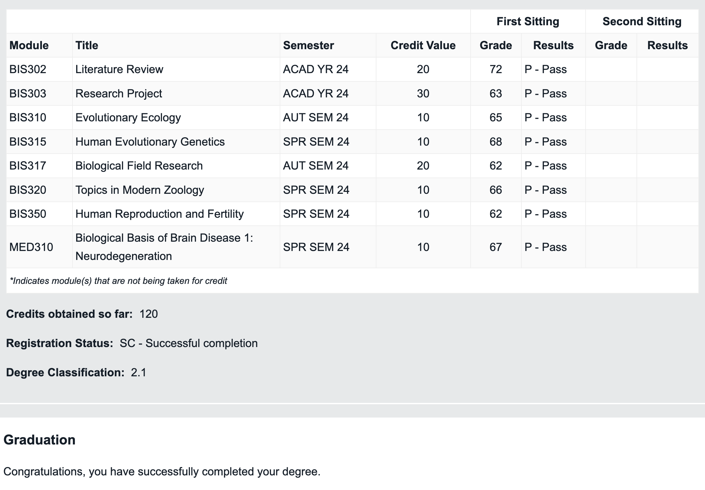
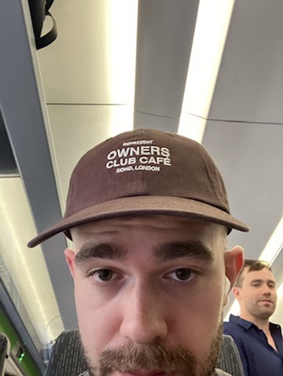

Just yesterday (a few days ago now, sorry I didn’t get round to posting), I opened up my exam results for my final year at university. And, after a period of worry when I couldn’t get through to the website, I felt a huge weight lifted off my shoulders when I looked at the screen…

<figure>

<figcaption>Mr. Consistent if I say so myself (at least more so than previous years)…</figcaption>
</figure>

I’d passed, with the grade that I’d been expecting for the last six months.

This now begs the question - what next?

In part, this was answered in [issue 91](/fm/091/), when I came back from the number of months I took off to make the above results possible.

My friend Archit and I were planning on heading to Reading and trying to find a house there. And we did. But the landlord rejected our offer to rent on the basis that I had no real employment.

My aim was to try and find part-time work in Reading whilst trying to make PARAZETTEL, as well as freelance photography work here and there, on top of the rest of my income.

But that’s not going to happen for the time being.

Archit is millimetres away from securing a job following the end of his degree apprenticeship, but luckily the position he’s most likely to pick is remote, which means he doesn’t urgently need high proximity to London.

My plan now is to remain put in my parents’ house in Bristol, and try to make the self-employment work as far as I can.

There was always the nagging feeling in the back of my head that I’d not given it my all (out of necessity) whilst studying, and wondering how far things really could go if I dedicated my everyday efforts to the business without added commitments crowding my head.

So that’s the plan, alongside as many enjoyable and exciting things that I can fit into my day as possible, with an intent to spread my net wide for opportunity.

Right now, for example, it’s 06:30 am and I’m writing (drafting I guess, because I didn’t get round to sending until much later) this issue on a train, on my way to London to do a run and see a shop opening and walk around the city with my film camera, on what’s probably going to be one of the hottest days of the year.

I hope it’ll be good. That’s what I love about PARAZETTEL as a business, and writing online as a whole. It means that I can work from wherever I want, at whatever time I want, so long as I have an internet connection.

And it’s something worth fighting for, I think. I don’t want to move into some second-rate apartment (the one we found was ideal, that’s why I was okay with putting the offer in) and have to sacrifice what I’ve built over the last three years in favour of a stable income to afford rent.

Making my dream work is something I feel I should at least give a real go. After this, if I have to put it on the side of another job, then so be it. At least I gave it a good shot. Went all the way.

------------------------------------------------------------------------

As for Fundamentalised, I’ll try to make my life not boring enough to mean there’s nothing to write about every week.

I’ll also keep you up-to-date with how the business is performing. Just yesterday we launched the PKM for Students course in the community, so I was glad to see my results come through as they did, showing that I know at least a little about what I’m sharing there.

If you want to learn more, you can [go to the PARAZETTEL Community here](https://skool.com/parazettel).

I’ll see you next week!

— Theo

------------------------------------------------------------------------

### Bits from REPRESENT’s shop opening in Soho…

(They teased somewhere to put down bags before the run, but this never materialised. This meant I had to run the best part of 5k with my 40L duffel bag tightened on to my shoulders. It was painful. What a great atmosphere though!)

<figure>

</figure>

<figure>

</figure>
