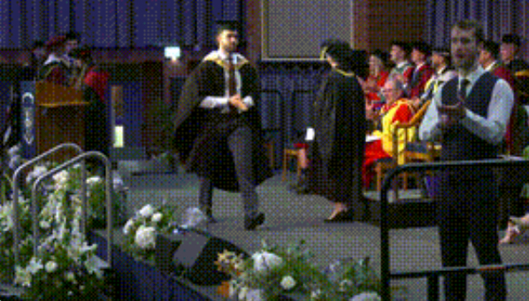
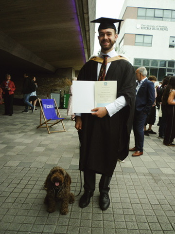

Two days ago, I booked a flight to Bangkok, Thailand, with no planned date of return.

I’m going to travel there in September, working and exploring the south-east of Asia, with no plans as of right now to come home…

But let’s rewind a little, because it was just the other day that I was talking about moving to Reading with my friend Archit…

To cut a long story short, as it’s not particularly flattering from my perspective, we got rejected from our application to our favourite of the viewed properties, because I don’t have a job that guarantees income.

So here we are.

Archit’s going to London this autumn now with his sister, who’s just secured her own degree apprenticeship, and that means I’ve got some room to try things out.

The solo entrepreneurship and remote work cultures are strong in south-east Asia, because of the relatively high quality of life for the price that it’s possible to have over there if you have the privilege of working on a laptop.

Although I’d want to live in Europe in the end, while I’m still starting the business, I’ve got to try and keep the expenses low when exploring. It’s going to be quite tight, even though the operational costs of what I do aren’t that high (another perk of being online).

And one thing I’ve also realised is - why not do it now?

Currently, I’ve got the fewest responsibilities I’m ever going to have in my adult life. Yes, I was going to start renting a property, and was also eyeing up buying a car whilst at home, but I’m only ever going to be able to travel Southeast Asia at 21 years of age once.

Is all of this wise, though? I don’t know. And that’s the exact reason I’m doing it. There’s a lot of new experiences and places to see, and I’m non planning on doing everything, just drinking it in and trying out a lifestyle that many who work in similar online professions seem to like.

I’m there to find somewhere with people that I can connect with, a decent price for my morning coffee, the gym and then some time to go to the beach. Maybe I’ll learn to surf. I skateboarded years ago, and crashing into water is normally less painful than crashing on to concrete.

Hopefully I’ll meet with people who will guide me or at least inspire me to scale my business further until it’s fully supportive of living. Although I’ve spent quite a lot of time working on it over three years now, it’s not really moved that far in terms of income.

The fact that I’ve only ever done it part-time up until a month ago plays a part, but I think that improving my overall environment (the people and the location being more aligned to my work, at least) will make a real difference.

As I said, though, I’m not sure what the trip will hold. But you can be sure that these newsletter issues are going to become more and more diverse, and filled with stories.

It’s going to be good. Stick with me through a few more weeks as I stay at home and try to keep building the business.

— Theo

**P.S.** *In terms of the business, we’ve actually been doing quite well since the end of uni. A few things have changed. I made my flagship Obsidian vault template free for anyone to download, but moved the main teaching meat of it to the PARAZETTEL Community, in a new course called the PARAZETTEL Course.*

*This way the resource lives online, meaning I can add updates and improvements a lot more regularly. It also allows me to continue the slow move of most of my teaching towards being tool-agnostic.*

*You can [download this new basic PARAZETTEL vault today](https://go.parazettel.com/) and get a good insight into how the system works, if taking notes in Obsidian is something you’d like to get started with. Email me if you’ve got any questions!*

### Graduation…

<figure>

</figure>

<figure>

</figure>
