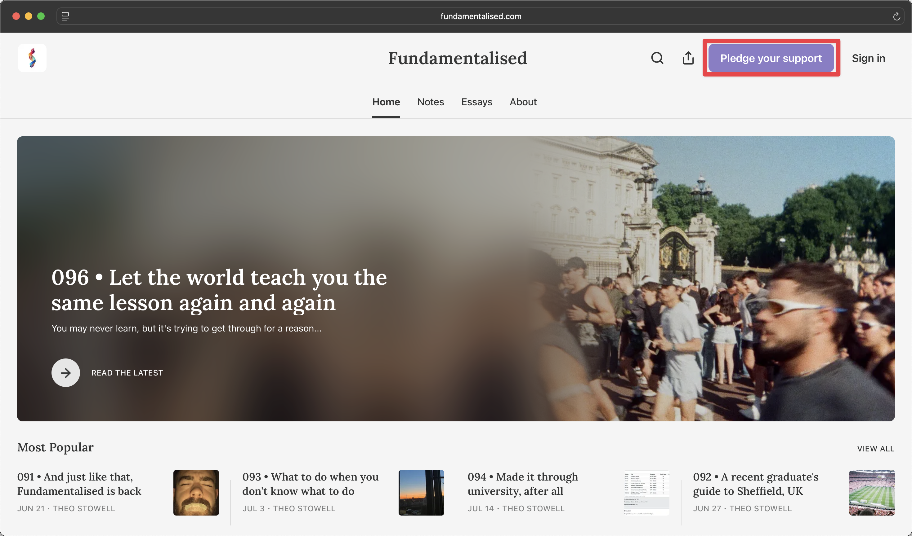

For a while, I wanted to write about this in a short essay (like the ones that I’ve now put up [on the main Fundamentalised website](/writing/), and will tell you about later). But I’m trying to live up to the idea that I should share everything [rather than gatekeeping ideas](/ideas/), so here you go…

*As far as I can tell, revising or practising in some kind of constrained way doesn’t help you in preparing for life (in this context, I’m talking about life and its events in a more abstract, long-term way, without short-term goals and outcomes defined - obviously you can practice/revise for these).*

In a way, you can’t prepare. You can only act. There’s no way of knowing for sure how things are going to pan out and therefore no way to prepare a suitable action or response in advance.

You can take this from a person who was into watching instructional self-help/improvement videos on many topics, learning, business, weightlifting, etc. - they don’t actually prepare you in any useful way for doing things in real life.

You might struggle with things the videos don’t address, and you might find other things easy when the videos suggest they are sticking points.

This rote input and advice in preparation don’t seem to help half as much as self-belief.

Like I believe that I’m the right person to do the things that I want to do. Even though there’s no way of knowing for sure, it feels inevitable that I’ll eventually stumble through and figure things out.

And I think the presence of this belief is something that’s tied to internal state rather than external circumstance.

You might recall me saying I was going to go to Reading to get a job and rent a flat with my friend, and that now I’m going to Thailand in exactly a month.

In a strange way, I don’t feel much different that things have changed. I back myself to make things work the way they are now, and I’d have backed myself to make them work if I ended up living in Berkshire.

There’s no way to revise or practice this belief. Unless you look a little deeper…

In essence, all the ability that’s required, outside of basic life skills, is resilience and adaptability. The more of this you build, the more self-belief that you have, that you can adapt or improve or withstand whatever comes your way.

And these only come through changes and updates in circumstance and events, which is paradoxically pretty much the opposite of what you get if you sit inside and watch videos and read books all day, preparing for the moment to perform.

And so the only real ‘preparation’ for life that you can have is by just continuing to live it. Choose to do things now, rather than to prepare to do them. 1,000 iterations is better than 1,000 hours of preparation, where possible, and there are relatively few moments where you can’t just simply learn from your present results and have another stab at things.

If you put yourself into situations, most often you will adapt. You just have to find the situations to put yourself into. It’s a little like an existential Parkinson’s Law. The more you put yourself through, the more your adaptability grows to tackle a wider range of and the more your self-belief in making the rest of your life work grows.

An example - a month or so ago I found out that my favourite clothing brand, REPRESENT, was opening their flagship store in London and hosting a 5km run around the city. Now I asked my friend Archit if he wanted to come with me, but he wasn't able to, so I travelled across the country, starting at 4:30 am, to go and take part, solo.

There, I met a group of people starting their own padel brand, and in conversation, things escalated. Last weekend I found myself at their brand launch event, shooting photographs and video for their social media…

From this, I have greater belief that I can go on to do it in Thailand and Bali - places that are swarming with creators, venues, events and influencers, who all need photo and video.

We’re going to see how far this holds up in reality in a few months, but do you see what I mean? I can’t prepare to go out and find people to take photos for any better than actually trying to go out and meet interesting people who, on the off-chance, need some shooting done.

There are no do-overs. You don’t get the time that you spend preparing back. You just have to act. This builds self-belief better than any kind of preparation or learning (that’s not actually doing the thing) can.

See you next week,

— Theo

------------------------------------------------------------------------

### About the essays and the future of Fundamentalised…

*If you don’t know, Substack offers subscription services to allow people to pay for access to a portion (or all, but that’s not my plan) of your content.*

*And as I start to travel, I’m going to need to make sure, first and foremost that my income is enough to support having something to eat and somewhere to sleep.*

*On top of my business PARAZETTEL, I thought that I could create more content here and offer a membership for people who are into reading about my thoughts and activities.*

*This won’t replace my income, but if I could get 10-20 people initially to sign up, that goes a long way to covering my accommodation whilst I travel, full stop. And in return, you get videos and exclusive essays that you can read and watch here on Substack.*

*It’s not coming quite yet (I’m thinking after issue 100, which coincidentally seems to line up almost perfectly with me flying out to Asia), but there’s an option to pledge a subscription…*

*On the main home page, [https://fundamentalised.com](/fm/), if you find the big purple button in the corner, it should say ‘pledge a subscription’. If you click this, you can enter your details. You won’t get charged until I actually activate the setting and start sending additional stuff.*

<figure>

</figure>

*When this moment does come, likely in the next few weeks, you’ll be in straight away, ready to make the most of the additional content I’m going to be writing and filming during my travels.*

*So if you fancy it, that’s the run-down on the updates. Pledge and you’ll be straight on the list when the memberships go live!*
