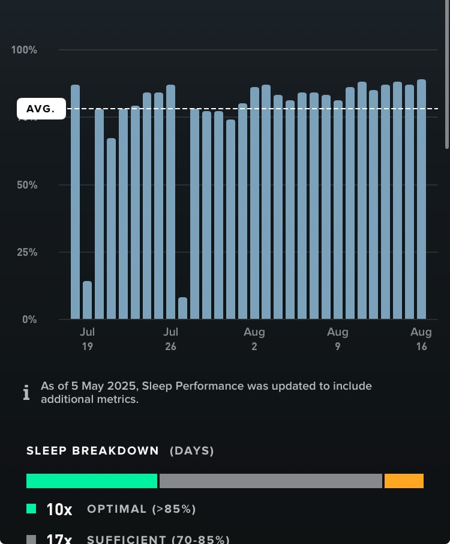
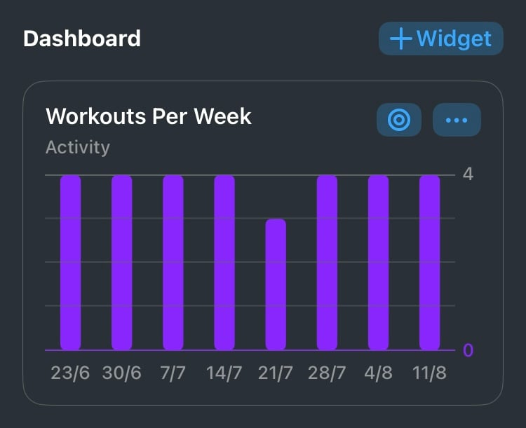

Sometimes you find yourself in a period of life where you don’t have much going on.

Although I’m heading to Italy for a week, in a week, and then Thailand a week after that, the last month or so has been quiet aside from one or two excursions.

And (mainly because there’s nothing much else happening) I thought I’d write a little something about nailing the activities we do on a ‘default’ day in our lives…the ones you’ve got time to do when the schedule’s quiet.

I try to make these things as beneficial to general progress as possible. This means looking after health, consistently sleeping and training well (shown are sleep quality and gym sessions per week)…

But I try not to get too neurotic about perfection (he says, as he shows the bar graphs in all their glory).

It should be a no-brainer to sacrifice this consistency in favour of progress in work or experience when the opportunities come back around.

However, there’s no harm in building good habits as a default when nothing is happening, as they compound very quickly.

Quiet days are individual opportunities to stack small wins or losses. And I’m a big fan of stacking these sorts of wins rather than trying to get the ‘one big thing’ right.

These landmark ones take care of themselves so long as you’ve put in the work on a smaller and consistent scale beforehand.

This might be sitting and having 10 minutes of peace (I like a guided meditation) before getting to bed at the same time every night.

It might be doing the hardest task of your workday as the first thing when you wake up, so that everything following this is a bonus, and you don’t feel behind.

Either way, they’re not that significant on their own, but they make a real difference over months and years.

I’ve written about this before, last June, but this time I’ve pre-empted my travel abroad somewhat (I’d gone to Belgium last summer before figuring this out)…

#### [053 • Daily routine and habits give you freedom](/fm/053/)

*There’s a quote from Gustave Flaubert…*

The same point was on my mind then - the more you stack the beneficial things when there’s little going on, the more resilience you’re going to have to an unpredictable schedule and new life experiences.

There’s not much on my end this week in terms of real updates, but next week I’ll be sending you an issue from Italy, so stay tuned for that.

See you then,

— Theo

------------------------------------------------------------------------

### What I’ve read this week…

***Simple Marketing for Smart People*** by Billy Broas and Tiago Forte - This book is a little bit of a hidden gem, especially for someone who runs a business in a very similar niche to Tiago.

The general idea is that we can get distracted by shiny objects and gimmicks in the world of marketing, but the most important thing to think about is the customer journey, knocking down the beliefs that hold them back from buying one by one, through well-targeted pieces of marketing content.

I’ve learned a few things that I’m going to try and take into [PARAZETTEL](https://go.parazettel.com) moving forward, to improve the communication of the products’ value to potential customers.

------------------------------------------------------------------------

### *One more thing…*

*Before I go away to Thailand and release my 100th issue, I’m going to try and put together a vlog to show a little snippet of what you may receive if I turn on subscriptions for Fundamentalised.*

*We’ll see how well this is received and then I’ll decide whether subscriptions are really the right way to go, or whether I continue to build an audience as I have done.*
