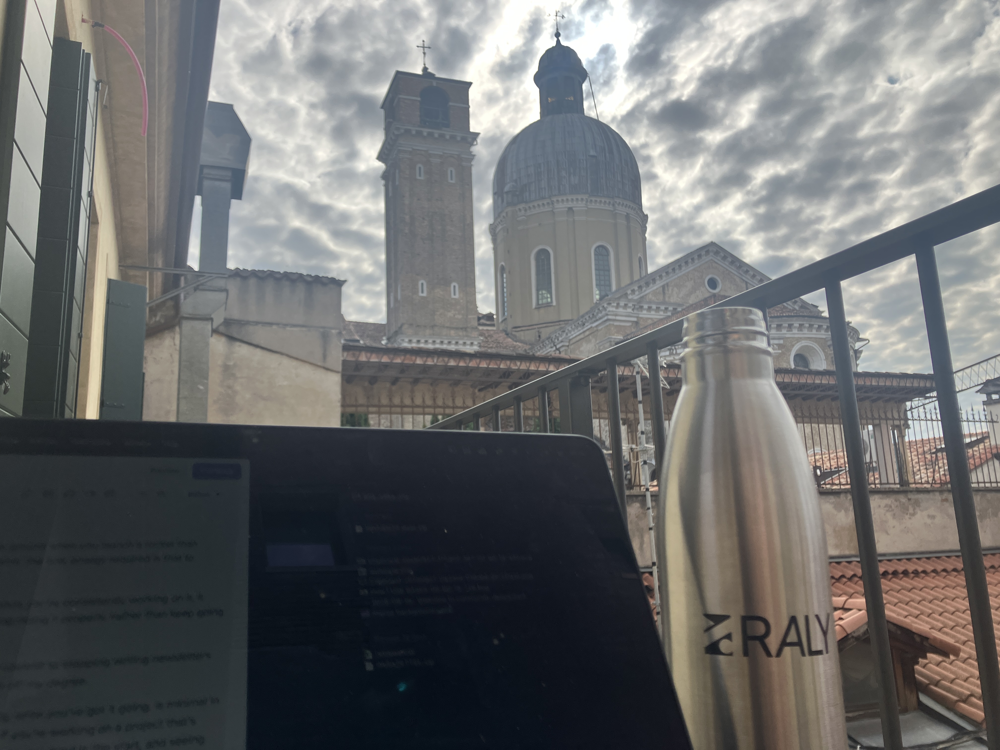
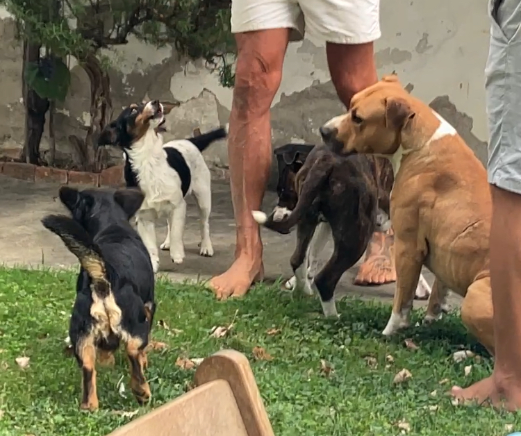

It’s been a long time since I studied physics, but I remember the concept of critical mass in a nuclear reactor.

In my own unscientific terms, it goes like this…

*High-energy free neutrons in the core collide with fuel rods containing uranium/plutonium, giving other atoms inside the fuel enough energy to release more neutrons. These cascade into other atoms, releasing more neutrons, and so on.*

*Each reaction releasing neutrons also releases heat, which is where the energy comes from. This becomes self-sustaining after a certain point, which is the critical mass.*

There’s another similar idea called activation energy, which is more relevant in chemical reactions. To reach activation energy, we might have to heat up a substance (to provide energy) to a certain point beyond which the atoms have enough kinetic energy to react, and do so.

They’re both metaphors for growing projects in real life, with the point being that the hardest part is to get started and build momentum, or as Peter Thiel puts it, go from ‘Zero to One’.

From my own experience, things get significantly more plain-sailing after this point, with much less effort required for the same results.

There are examples from my life and from my business…

Now that I’ve reached the critical mass of pieces of writing under my name across all platforms, I get viewers to my business landing pages every single day, on autopilot.

This means that I don’t necessarily have to work as hard to get as many eyes to my writing, even if the work I produce isn’t of much greater quality.

Contrasting to this is my community product - I write a post in there every day to contribute to the engagement.

However, once I’ve grown it to the critical mass of members, they’ll start more conversations themselves and interact with each other without my prompting. I know it takes more energy to get off the ground than anything else when you launch a rocket.

Then, when you’re in orbit, the only energy required is that to adjust direction.

This energy in itself is a lot less, but not insignificant - once you’re used to working on a project, it takes extra thought and commitment to make a clean break from it, rather than to keep going.

I wrote about this and how difficult it was to commit to stopping writing newsletters whilst I needed to work harder at uni to finish off my degree.

If you’re working on a project that’s tough at the moment, give yourself the grace of putting serious effort in the start, and then see how things feel when you reach critical mass and results come even when you’re coasting.

------------------------------------------------------------------------

Anyway, I’m in Italy at the moment, and thoughts of reaching critical mass in any of my projects are somewhat out of the window. Here’s where I’m writing from…

<figure>

</figure>

And who I spent my lunch with yesterday…

<figure>

</figure>

In the rest of the week, I’m going to Venice, spending some more time in Padua, and going to the Dolomites to hike and take photos.

I’ve already been using my film camera a lot, and will get it developed when I’m back in the UK, sharing the best photos here.

------------------------------------------------------------------------

One more thing…

The next issue is number 100. I’ve not quite decided what I’m going to do for it yet, but I’ve got some ideas.

Hopefully I’ll find time to edit in between everything I’m doing this week, and I look forward to releasing it (hopefully on the weekend, but it’s always just a hope).

See you then,

— Theo
