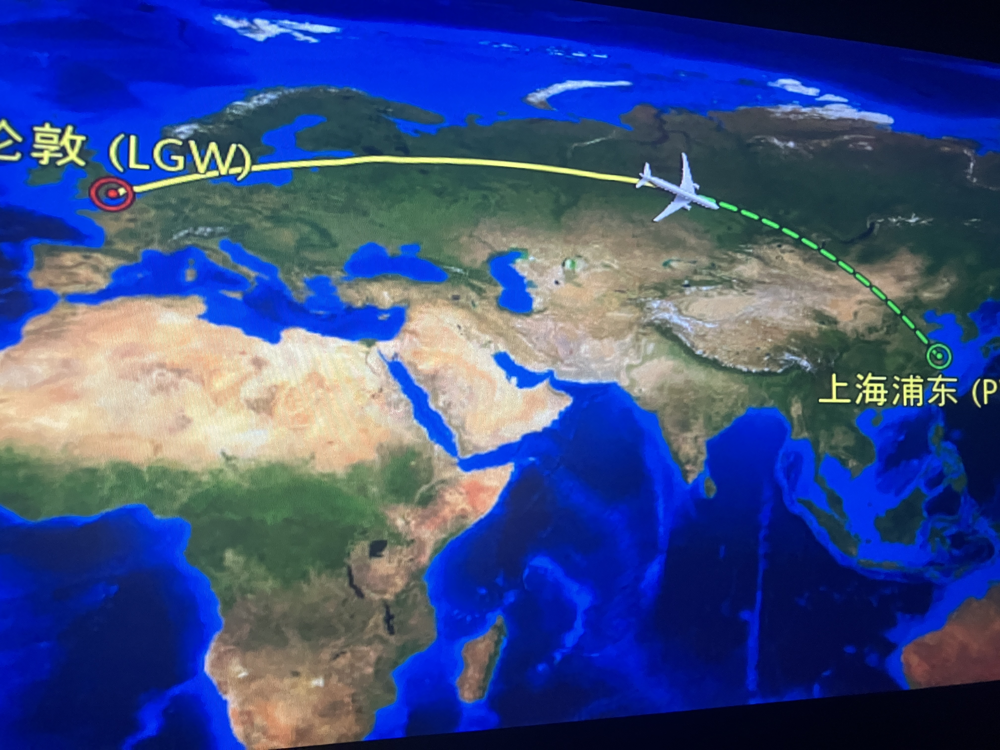
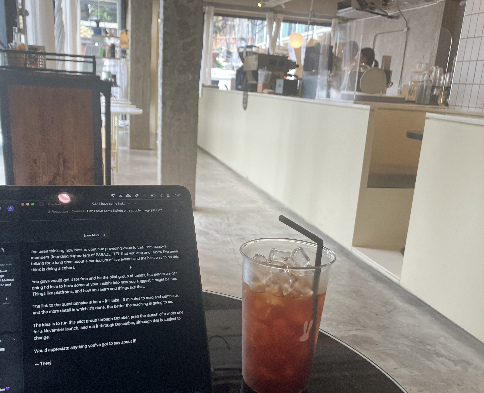

I first started drafting this issue sat in Shanghai Pudong airport, but I’ve made it through to Bangkok, and now share this with you (at least these first few lines) whilst sat inside my hostel.

Before long I’m going to head and try to find caffeine before continuing this issue, because although I slept very well, or at least I did according to Whoop, it’s still technically 2 am inside of my body and I’m not quite as sharp as normal.

But anyway, I thought I’d tell you about my journey from Bristol to Bangkok, one side of the world to the other…

We started at 11 am at Bristol Parkway station, arriving a little later (and late) to Reading, where I missed the train to the airport by seconds.

Luckily I’d given myself a lot of time to arrive and board, so I waited patiently for the next airport train and pulled up still four hours or so before my flight.

This turned out to be a good thing because, having not flown long-haul before I made a bit of a mess of checking in, getting through security and being ready to fly…

First of all, I treated everything like a Ryanair flight, just trying to scan my boarding pass through into security right away.

It declined, and I was forced to go and find the check-in desk, which I now know is mandatory even though I checked in online...

As I was queueing for the check-in, I noticed a sign nearby saying cabin carry-on is 8kg (this was okay) and the personal item was supposed to be 2kg.

Damn. I was hoping that my duffel full of clothes would be my carry-on, but apparently not.

So I whipped out my cross body bag to serve as my personal, and emptied some of my backpack into it to make sure I was hitting the right weights for the carry-on and the personal item, and had to then rearrange my duffel to take all the electronics out and put them in my backpack.

And *then* I had to check the bag into 'oversized luggage' (it wasn't), just because it had straps on.

Following this I was finally free to head through security. Which I did, with someone I'd met suffering from the same 'oversized baggage' curse as me. She was heading to Bali from Shanghai, rather than Bangkok, and then from Bali on to Melbourne to work as a camera operator.

Now as you may know this is the kind of area I'm interested in working in, eventually filming for wildlife/nature programs. So I took her contact details and might now plan a leg in Oz to see if I can get involved in this either shadowing or as a runner or something.

But anyway - I didn't manage a wink of sleep on the eleven hour flight to China. It was just me and the flight information screen, watching as we passed over St. Petersburg, Tomsk (I could swear we were flying over Tomsk for hours), then Mongolia and finally China, all the way to the east coast…

<figure>

<figcaption>I did watch The Martian as well, a film I love…</figcaption>
</figure>

So I was discombobulated as I wandered through Shanghai Pudong and watched as security for my connecting flight confiscated my 'survival charger' (it's got a solar panel built-in) as it was too powerful, and then as they all spent five minutes convening to empty out the electronics from my bag. I'd packed everything neatly into a sub-bag, and watched as this was ruined and they all puzzled over what the hell my camera remote was.

But after this, I was through. I decided to grab a coffee seeing as it was now 1pm (6 am back in the UK). I drafted a few bullet points for the trip so far, and then it was time to head on to the four-hour flight to Thailand.

Thankfully I managed to grab a nap (finally!) on this flight and didn't feel too bad as we touched down in Bangkok.

Hopping off, I made sure that I had my arrival card (all you need to get in if you’re British), and made finding a SIM card my priority whilst making my way into arrivals.

Luckily there was a stall right there and so I got ripped off (can't prove this but it seems likely) for a few gigabytes of data. I have an eSIM ready to go, but you need internet connection to get this installed to start with.

Then it was a bus, then a Grab (Thailand's version of Uber), finally touching down at my hostel.

Throughout this whole time, my mind was mulling over the fact that I was now literally on the other side of the globe. It's very strange as a feeling. But at the same time so familiar because I'm the same person I was back in England. Everything now was being seen through my eyes, rather than that of someone else vlogging.

And I've not managed to see much yet. After all, I'm here to live and work, rather than as a tourist, and although the visiting attractions side of things is going to creep in a little, I'm determined to make this work for longer than just running out of money and motivation after a month. Because of this (I’ve moved since writing the opening lines) it was on to a café this morning to get this issue written…

<figure>

</figure>

As I was cruising across the globe and transferring and making my way here I did capture a few clips of things as well, so at some point I'm going to try and put together a video roundup.

It's so, so loud here though, everywhere. It's hectic. Maybe I'll try and find an electronics shop so I can buy a lapel mic which records audio I can then sync over my camcorder clips. Considering how bad the device itself is already, this will be the only way you’ll ever hear anything from me.

Anyway, that's it for now. I'm going to try and keep posting things, so look out at my socials underneath (the email footer should contain them now), as this is where I'm going to try and share things with you.

And sorry this is such a long issue…

I'm going to try and tie in the lessons and things as I have been doing, but this might become more of a travel blog, at least until I find somewhere to settle down longer-term. Keep an eye out for the essays on the site though, as I’ll share more and more in between issues as I learn things.

Thank you for reading! I'll see you soon,

-- Theo
