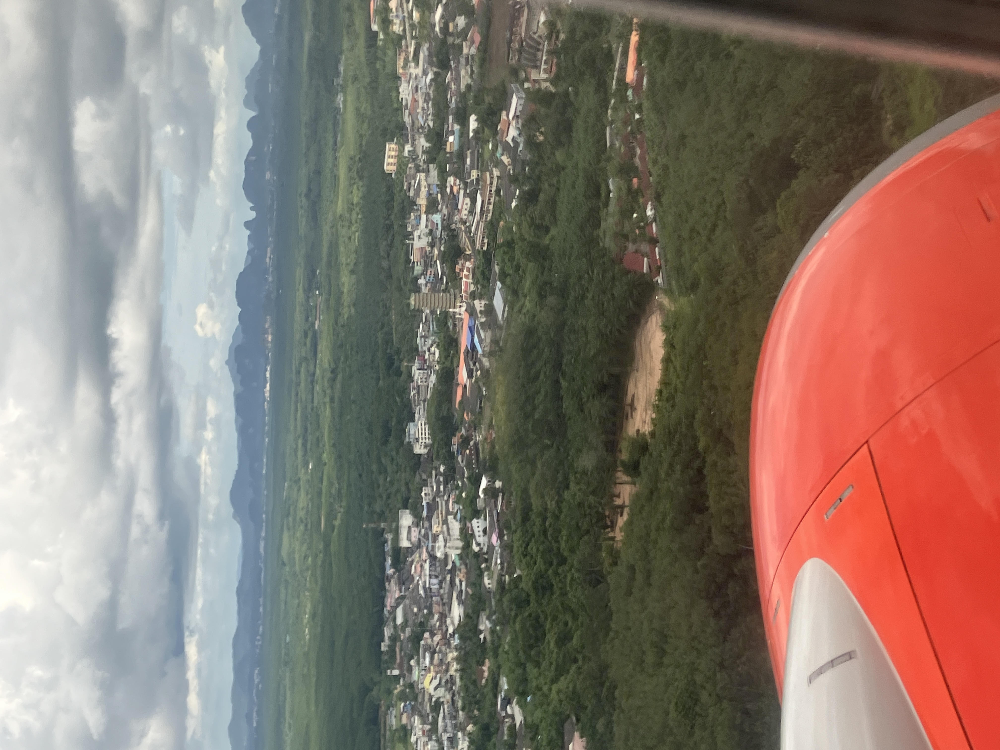
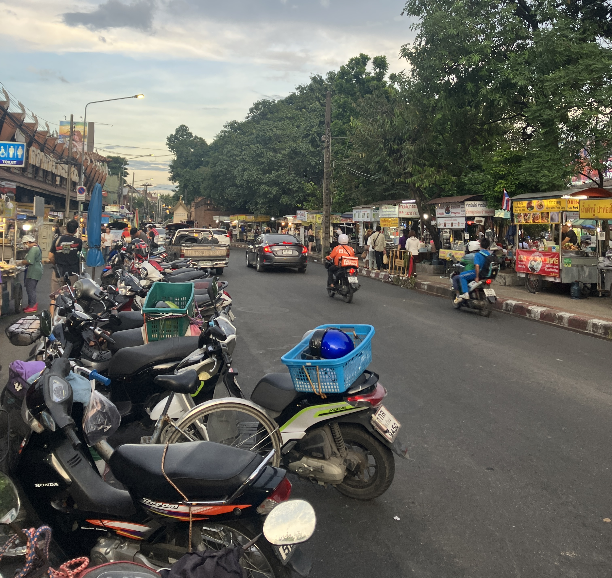

I made it out of the chaos of Bangkok. An hour and thirty minutes in the air last Sunday took me to Krabi, where I then took a taxi to Ao Nang (and now, as I’ll explain in the rest of the issue, I’m in Chiang Mai where I’m trying to finally finish off this issue).

<figure>

<figcaption>Flying in to Krabi</figcaption>
</figure>

<figure>

<figcaption>Near Chiang Mai gate, about 2 minutes from my accommodation</figcaption>
</figure>

In Krabi, the beach was a five minute walk away, at the end of the main road. I could have swam every morning if I wanted (and actually ended up doing so most of the nights). It was also a little cooler with the sea breeze blowing in.

It was definitely a different vibe to previously - in Bangkok I didn’t stay in tourist areas. Ao Nang, on the other hand, houses only tourists and locals who have businesses to cater to the tourists.

So I was sucked into spending time out, especially at night (when I first wrote this it was one night. I can now confirm that I didn’t get to bed before 2 am on any of the nights I spent in Ao Nang or nearby Railay).

I’ve not managed to edit any videos. No Instagram reels either. And of course this issue has taken more than a week and a half to come out.

But this needs to change. It’s one of the lessons I need to keep learning in that the real fulfilment comes from creating stuff and putting it out into the world. This can include energy in interaction with people, as has been the case more recently, but can also be from this content that I put out.

Naturally I’m introverted (although I try my best to be outgoing), and can drop into the flow of creating things by myself a lot more easily.

I’ve not managed this at the moment much, but I did take some photos in Bangkok and did have some photos taken of me…

In the next couple of days, now that I’m in Chiang Mai, I’m going to try and put together some videos. Ones that show what I’ve captured of the journey so far, in much more detail than I could tell in words.

Also the business needs a little more focused attention. I don’t want to lose the limited momentum I’ve built up since graduating university, so there needs to be more produced on my end, continuing teaching.

Anyway, I’ll be back with some more stuff soon. The ‘holidaying’ is pretty much out of my system now, and I want to mainly work and train, mixing in the advantages of being somewhere like Chiang Mai, mainly the nature, the food and culture (which seems stronger than Bangkok, the limited experience of both places I’ve had), as well as the coffee, work locations, gyms and networks.

Once I start doing this, I’m going to be able to share more detail in Fundamentalised, so stay tuned for this!

**P.S.** *I’m thinking of turning Fundamentalised into a sort of travel diary or blog or something similar, and then making the Essays that you can find on the home page where I share some of my deeper ideas and lessons.*

*[You can look at them now to see what I mean.](/writing/)*
