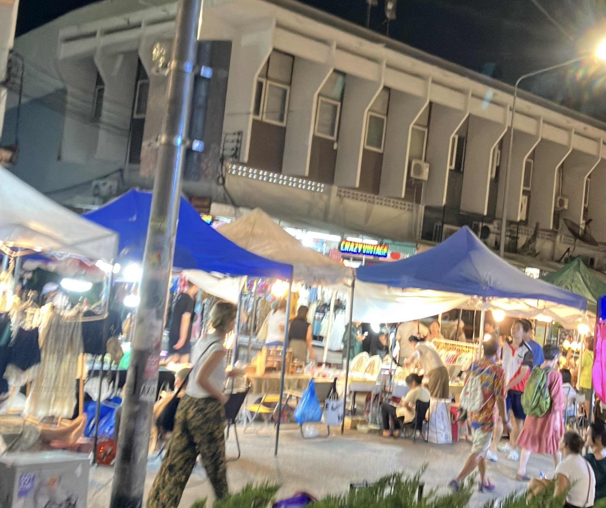

It feels like just moments ago that I was writing a post here, but we’re a little behind schedule with content in every dimension at the moment, so we’re back again for another issue…

I’m still in Chiang Mai, and am still loving it here.

<figure>

</figure>

It’s less hectic than Bangkok, and you don’t get shilled something at every street corner (I know there are probably areas of Bangkok where you don’t, but I didn’t care to travel miles to find them).

The people you meet are staying for longer, and so you build up better relationships with them, rather than knowing them for one night and then having to leave.

Things cost quite a bit less (important for me at this point in my journey), and there are fewer ‘things to do’ from a tourist sense which is good, because most of my time in the day now is dedicated to making

The bars close at 1 am, so my English brain (although disappointed in the moment) can pretty much recover to work in the morning, even on the latest nights.

However, it’s only the second city (and third location) that I’ve visited in the whole of Southeast Asia.

It seems to me a little foolish to settle down before trying at least a few more places.

And I don’t have unlimited time in Thailand anyway. My period to remain in the country runs out at the start of November and according to a Dutch man I met in the food court in the mall the other day, the Thai government is becoming more and more strict around accessing visas.

The Destination Thailand Visa (DTV), designed for remote workers and digital nomads, requires me to have about 15 grand in savings and semi-permanent property deeds.

And, of course, I don’t have these things. So I’ll have to leave for periods anyway. And that’s alright.

Right now, I’m eyeing up the working holiday visa for Australia, which allows me to stay there for up to year and work online. This is ideal - and it costs about 300 quid and requires me to have ~£2500, which is much more manageable than the DTV.

I also think that I’d like it in Oz a lot. I’ll get some kind of work part-time (as the country is more expensive in comparison to where I am at the moment), and work on the business the rest of the time.

But as of right now, my semi-concrete plans only include Da Nang in November to meet in-person for the first time, after knowing him for more than two years, as well as China and potentially India in the New Year.

I’m not entirely sure about where things will go. But I’m just getting started.

See you again soon,

— Theo

**P.S.** *There’ll be new videos and reels soon, I promise! Have been struggling to sit down and record because everywhere’s so loud and*
