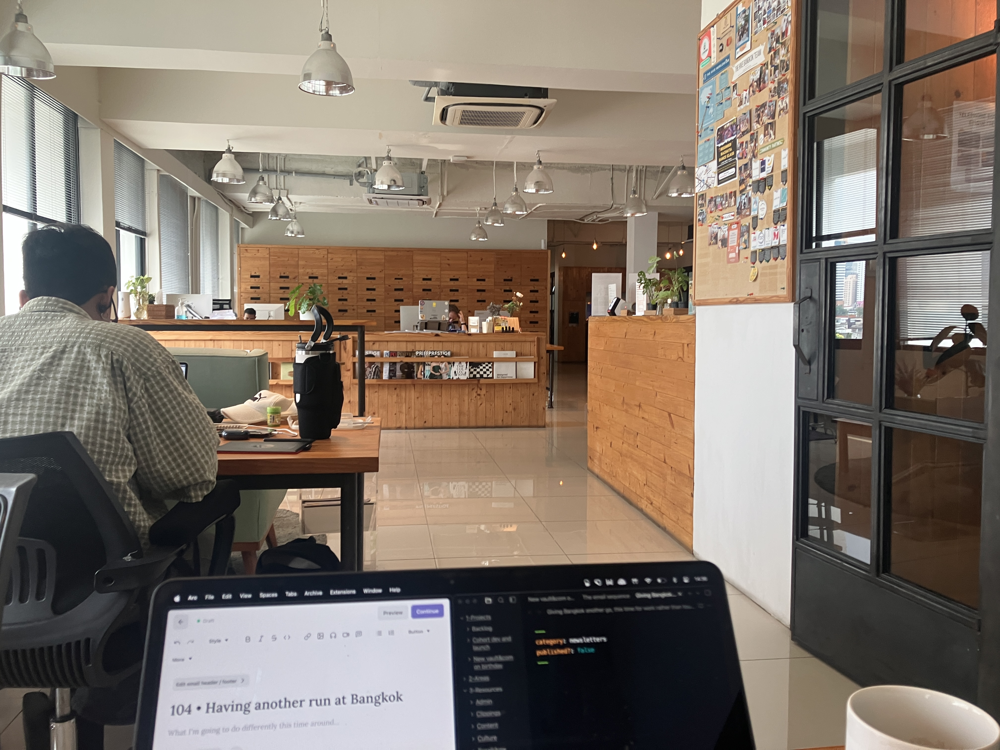

I think I did Bangkok wrong when I first arrived…

Well, not entirely wrong - I met fantastic people I then travelled with up until yesterday, and built memories with them that I hope will last a lifetime.

When I first travelled there, three weeks ago, I spent much time in the tourist centres, very close to the ancient temples and party roads.

Consequently, I spent most of my time the first time I was there visiting at tourist attractions and partying.

Now I’ve moved way out of town, on the airport-end of Sukhumvit Road, and am living in a hostel that seems as though it has only six residents and is very close to some world-class but cheap amenities…

I’m writing this from a co-working space, with a food prep service very close by, and (supposedly) the best gym in Thailand lined up for when I finish.

*(Update - the gym wasn’t all that - no water fountain, bad AC. Great machines, but absolutely huge inside, perhaps there is a happy medium in gym scale after all…)*

<figure>

</figure>

It’s a departure from what I’ve been doing whilst I’ve been here, like riding scooters, climbing up to lagoons and relaxing on beaches.

But it feels like home now, because when I’m home, working and gym is a lot (read ‘all’) of my everyday activities. So it’s work and training for the time being.

My friend just asked me if I knew whether I was going to make this work as of right now, and I’m not entirely sure - because everything has been so varied and because I’ve not had time to live securely in one place, I don’t know.

It’s not something that I think is going to reveal itself soon either - right now the business has some plans for the next month and I need to see how October here and November in Vietnam pan out.

The Destination Thailand Visa is going to be impossible to get a hold of at the moment as well, because it requires money that I don’t have access to, so maybe two months per place at a time, at the most stable end of things.

This blog (I’m going to start calling it that, because it’s less and less like a newsletter by the week) will always be the best place to keep track of what I’m doing as well - I’ll keep you updated!

— Theo

**P.S.** *Even though I said I could maybe live in Chiang Mai, my flight to Vietnam is from Bangkok, and being in the city is much better for amenities and flexibility for when I want to fly out.*

*So I’m here for now. Maybe I’ll go back to Chiang Mai in the future though, because it’s still been my favourite location so far.*
